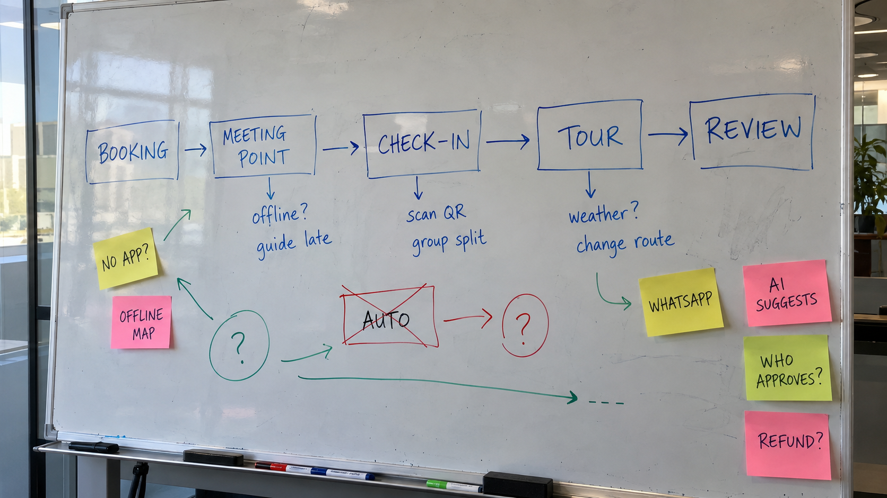

# Whiteboard: Day of Tour

Transcription of a whiteboard photo, cross-referenced with the project documents. The content is handwritten; marker and sticky-note colors are noted because they seem to distinguish types of notes. Relationships marked as *interpretation* are readings of unlabeled arrows.

**Sources referenced**

- **PRD**: Harbor & Pine PRD v0.9 (May 11, 2026)
- **Pre-kickoff**: Harbor and Pine Pre Kickoff (May 8, 2026)
- **Kickoff**: Kickoff transcript (May 12, 2026), cited by timestamp
- **Guide A / Guide B**: Guide interview notes (May 13–14, 2026)

The author and date of the whiteboard are unknown, so it's unclear whether it was drawn before or after the kickoff.

## Transcription

### Main flow (blue marker)

Booking → Meeting Point → Check-in → Tour → Review

| Stage | Notes below the stage |
|---|---|
| Booking | — |
| Meeting Point | offline? · guide late |
| Check-in | scan QR · group split |
| Tour | weather? · change route |
| Review | — |

### Green marker notes

- A circle with **"?"** below the flow, between Booking and Check-in.
  - One arrow points to the **"No app?"** sticky note, and from that note another arrow points toward the space between Booking and Meeting Point.
  - One arrow points to the **"Auto"** box (crossed out).
  - A long arrow runs to the right and ends in a dashed line (**"- - -"**), with no defined destination.
- An arrow runs from the **Tour** notes ("weather? / change route") to the **"WhatsApp"** sticky note.

### Red marker notes

- A box labeled **"Auto"**, crossed out with an X.
- An arrow runs from "Auto" to a circle with **"?"**.

### Sticky notes

| Sticky note | Color | Location |
|---|---|---|
| No app? | Yellow | Left, below Booking |
| Offline map | Pink | Left, below "No app?" |
| WhatsApp | Yellow | Below the Tour notes |
| AI suggests | Pink | Right column, below Review |
| Who approves? | Green | Right column |
| Refund? | Pink | Right column |

## Context from project docs

### Resolved

**No app?** No required download. The Executive Lead states it explicitly (Kickoff 15:30), Sales adds that hotel guests need a link that opens right away (Kickoff 14:38), and the PRD sets it as a day-of requirement: meeting-point instructions, voucher, support and updates without a required app download. The Pre-kickoff also lists the target platform as a link travelers can open on a phone. *Interpretation:* the arrow from this note toward Booking → Meeting Point likely represents the link connecting the booking to the day of the tour.

**AI suggests.** The assistant may recommend alternatives but must not change a paid booking on its own (Operations, Kickoff 13:14; Executive Lead, Kickoff 13:34; PRD product principles). *Interpretation:* this note seems tied to day-of changes rather than to Review, since the Executive Lead's example is moving a traveler to another tour when one is canceled (Kickoff 12:43).

### Partially resolved

**Who approves?** Human approval is required for important changes to paid bookings, but who approves is not defined. Operations says it depends on the change and can't give one rule (Kickoff 14:02), and escalation doesn't always go to the same person (Kickoff 23:30). Still an open question in the PRD.

**offline? / Offline map.** Critical information must work with a weak connection, but the offline dataset and refresh behavior are not defined (PRD). The Tech Lead raises whether offline means after the link has been opened once (Kickoff 15:10). A live map is not a requirement (Sales, Kickoff 16:40); a current photo and a clear address may help more (Operations, Kickoff 16:16), and Guide B suggests a better meeting-point photo may be worth more than another screen. Guides want the meeting point and group details available without reception (Guide A, Guide B).

**weather? / change route → WhatsApp.** Confirmed pain point: Operations moved three tours for weather, and one group still went to the original meeting point (Kickoff 00:48). Guides also change routes on the spot, for example when a street is blocked (Guide A). *Interpretation:* the WhatsApp note likely reflects the current channel, since many operators reply by email or WhatsApp (Kickoff 05:55) and Guide B would keep using messaging until trusting a new tool. Both guides want to know about changes before travelers receive them. The relationship with existing messaging needs research (PRD).

**guide late.** Confirmed as a frequent day-of issue (Operations, Kickoff 10:04; the hotel case, Kickoff 01:34). Guides want to report delays quickly without typing a long explanation (Guide B), and the PRD includes delay reporting in the guide experience. What the traveler receives and who acts is not defined.

**group split.** Some groups arrive together and some don't, and guides handle it differently (Operations, Kickoff 17:56). Guide B tracks it from memory and wants a quick way to record no-shows. The PRD lists split arrivals as an exception, but partial arrival was not covered in Guide A's interview and no rule is defined.

### Still open

**Refund?** Operations asked to include rescheduling, no-shows and refunds (Kickoff 22:04) and ruled out a single cancellation policy because operators have different agreements (Kickoff 22:32). The PRD lists refunds as an Operations responsibility. No flow is defined, and refunds were not covered in the guide interviews.

**scan QR.** Not mentioned in any source. The only related information: the voucher currently represents the reservation (Kickoff 17:56), and some operators check a reservation while others need individual attendance (PRD). This appears to be a whiteboard idea, not a validated requirement.

**Auto (crossed out) → "?".** No source explains it directly. Two readings are consistent with the documents: automatic confirmation for all inventory was discarded (only connected inventory can confirm immediately; manual inventory requires operator approval, Kickoff 05:55–06:31 and PRD), or automatic changes to paid bookings were discarded (Kickoff 13:14–13:34). Either fits the PRD principle that automation should reduce repetitive work while important changes require human approval. Which one was meant can't be confirmed.

**Green "?" circle, dashed line and sticky-note colors.** No source helps interpret them.

**Review.** The only reference is the last step of the PRD traveler journey: receive follow-up and leave feedback.

## Questions for the team

- Who drew the whiteboard, and when relative to the kickoff?
- What does the crossed-out "Auto" refer to: confirmation, check-in or booking changes?
- What do the green "?" circle and the dashed line represent?
- Is "scan QR" a proposal for check-in, and does it fit operators that track individual attendance?
- Do the sticky-note colors mean anything?
